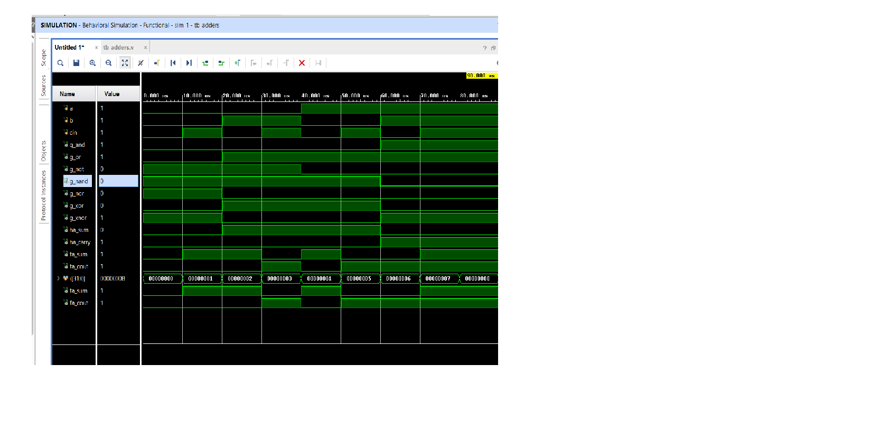

# Verilog Logic Gates, Half Adder and Full Adder

Basic digital circuits written in Verilog and simulated in Xilinx Vivado.

## What's inside
- `src/design.v`: basic gates, half adder, full adder
- `tb/tb_adders.v`: testbench covering all input combinations

## How to run
1. Create a Vivado RTL project.
2. Add `src/design.v` as a design source and `tb/tb_adders.v` as a simulation source.
3. Run Behavioral Simulation.

## Waveform

## What I learned
- How logic gates, half adders and full adders work
- Writing modules and testbenches in Verilog
- Simulating and reading waveforms in Vivado